

<a href="https://srielle.netlify.app/"><picture><source media="(prefers-color-scheme: dark)" srcset="assets/hero-dark.svg">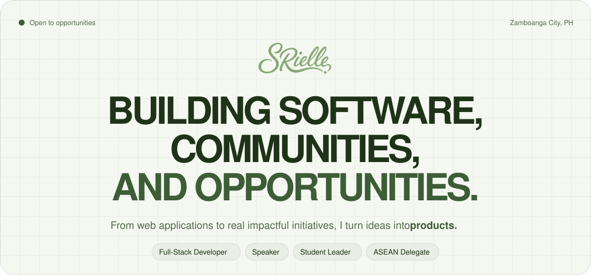</picture></a>

 

<a href="https://srielle.netlify.app/"><picture><source media="(prefers-color-scheme: dark)" srcset="assets/btn-portfolio-dark.svg"></picture></a>&nbsp;<a href="https://www.linkedin.com/in/gabrielle-tatel-3b337b2b9/"><picture><source media="(prefers-color-scheme: dark)" srcset="assets/btn-linkedin-dark.svg"></picture></a>&nbsp;<a href="https://srielle.netlify.app/resume/gabrielle-tatel-resume.pdf"><picture><source media="(prefers-color-scheme: dark)" srcset="assets/btn-resume-dark.svg"></picture></a>&nbsp;<a href="mailto:tatelgabrielle19@gmail.com"><picture><source media="(prefers-color-scheme: dark)" srcset="assets/btn-email-dark.svg"></picture></a>

I'm **Gabrielle Tatel**, a full-stack developer and BS Computer Science student at Ateneo de Zamboanga University. I build software for campuses, local businesses, and communities in Mindanao, and I speak and lead student organizations when I'm not shipping.

<picture><source media="(prefers-color-scheme: dark)" srcset="assets/stack-dark.svg">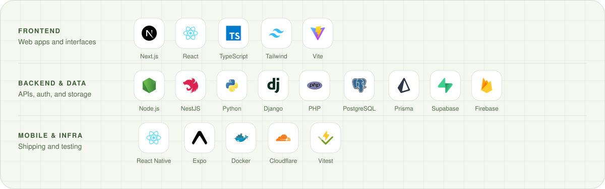</picture>

 

<picture><source media="(prefers-color-scheme: dark)" srcset="assets/h-projects-dark.svg">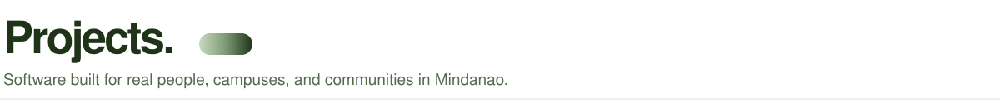</picture>

<a href="https://github.com/RielleTatel/council-of-organizations"><picture><source media="(prefers-color-scheme: dark)" srcset="assets/p-coaz-dark.svg">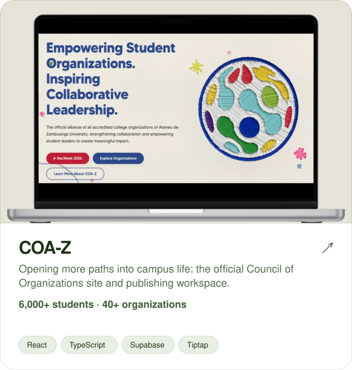</picture></a>&nbsp;
<a href="https://github.com/RielleTatel/unyon-mindanao"><picture><source media="(prefers-color-scheme: dark)" srcset="assets/p-unyon-dark.svg">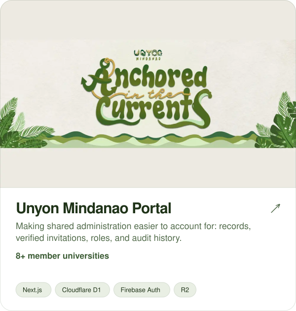</picture></a>  
<a href="https://github.com/RielleTatel/autocare"><picture><source media="(prefers-color-scheme: dark)" srcset="assets/p-autocare-dark.svg">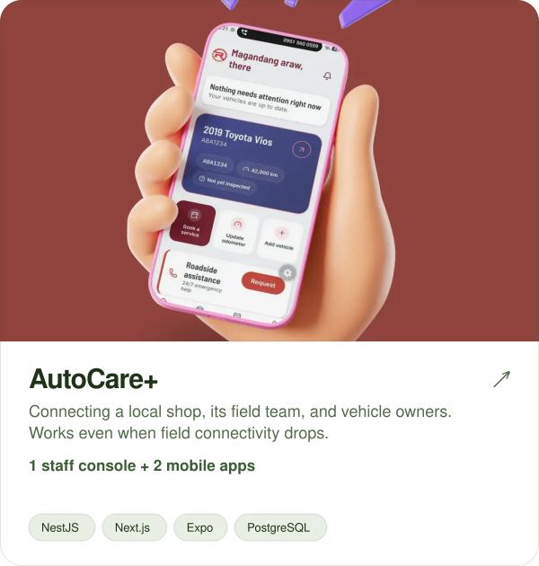</picture></a>&nbsp;
<a href="https://github.com/RielleTatel/ambagan-"><picture><source media="(prefers-color-scheme: dark)" srcset="assets/p-ambagan-dark.svg">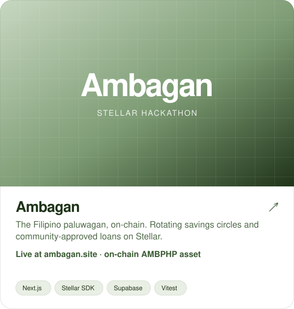</picture></a>  
<a href="https://github.com/RielleTatel/osa-system"><picture><source media="(prefers-color-scheme: dark)" srcset="assets/p-osa-dark.svg">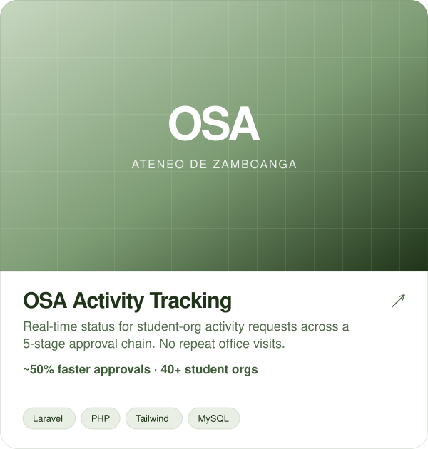</picture></a>&nbsp;
<a href="https://github.com/RielleTatel/debately"><picture><source media="(prefers-color-scheme: dark)" srcset="assets/p-debately-dark.svg">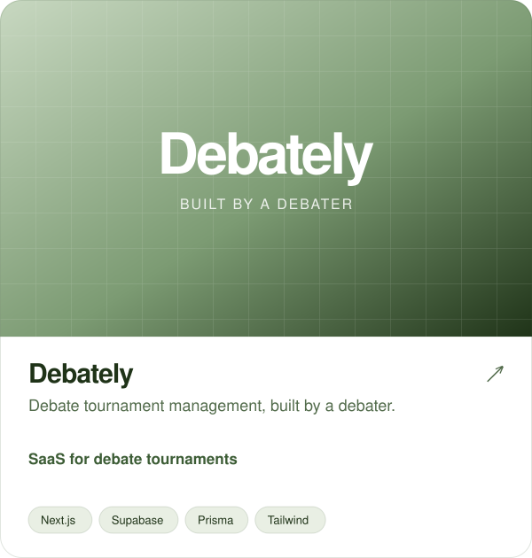</picture></a>  

 

<picture><source media="(prefers-color-scheme: dark)" srcset="assets/h-experience-dark.svg"></picture>

<picture><source media="(prefers-color-scheme: dark)" srcset="assets/experience-dark.svg">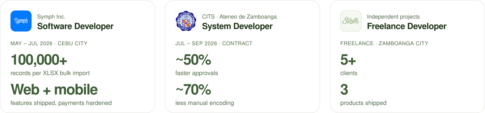</picture>

 

<a href="mailto:tatelgabrielle19@gmail.com"><picture><source media="(prefers-color-scheme: dark)" srcset="assets/contact-dark.svg">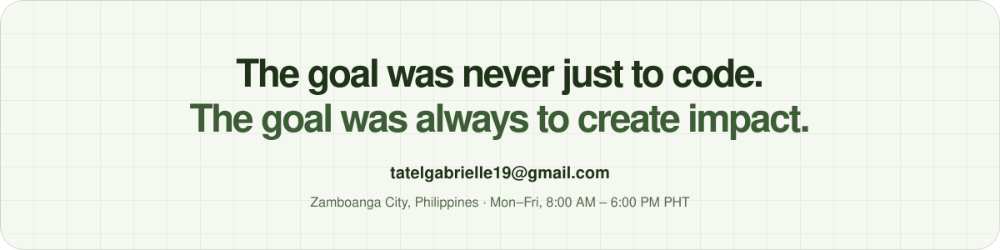</picture></a>
